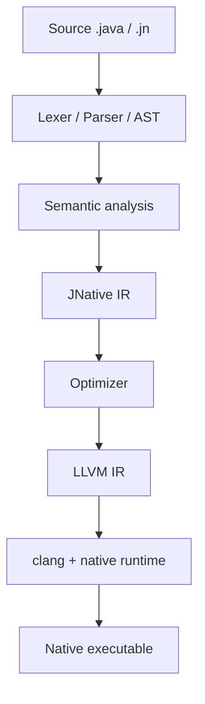

# JNative

**JNative** is an experimental **Java-like language** and **ahead-of-time native compiler**.

You write a familiar subset of Java-style source (`.java` or `.jn`). The compiler—itself a Java 21 program—lowers that source through a private IR, emits LLVM IR, and links a **native executable** with `clang`. The resulting program does **not** need a JVM or JRE at runtime.

JNative is **not** Java SE: it does not implement the full standard library, does not load arbitrary JARs, and does not claim HotSpot compatibility.

[中文](README.zh-CN.md) · [Getting Started](docs/en/getting-started.md) · [Architecture](docs/en/architecture.md) · [Language](docs/en/language.md) · [Contributing](CONTRIBUTING.md)

---

## Why this project exists

**Java-shaped source, native executables, compiler internals you can read.**

The interesting questions are compiler questions: precise GC with shadow stacks, effect annotations, IR optimization before LLVM, FFI that stays outside the managed heap, and how much “Java feel” survives without a JVM. Marketing slogans are intentionally avoided; status tables below track what actually works.

---

## Status at a glance

CLI version: **`JNative 0.32`** (`java -jar target/jnative.jar --version`). Prefer that over `pom.xml` if they disagree.

| Capability | State |
|------------|-------|
| Lexer, parser, AST, semantic analysis | ✅ |
| High-level IR + optimizer (`-O0`…`-O3`, default `-O2` for single-file) | ✅ |
| LLVM backend → native executable | ✅ on **macOS arm64** (primary verified host) |
| Classes, inheritance, arrays, casts, interfaces* | ✅ |
| Generics (basic); wildcards | ✅ / 🚧 wildcards |
| Lambdas & method references (SAM) | ✅ |
| Exceptions + declaration-form try-with-resources | ✅ |
| Generational GC (GC2), precise roots | ✅ |
| Native FFI (`@Native`, native structs) | ✅ |
| File I/O, TCP, HTTP stdlib, threads | ✅ (maturity varies by API/OS) |
| `wasm32-browser` | 🚧 experimental |
| Package manager / mobile CLI | 🚧 experimental |
| Multi-OS CI (Linux / Windows) | 📋 planned |
| Full Java SE / arbitrary JARs | ❌ not a goal |

\*Interfaces without default or static methods.

✅ = implemented with tests on at least one host · 🚧 = experimental · 📋 = planned · ❌ = out of scope

---

## Hello, World

Verified against the current compiler (`examples/guide-hello/src/Main.jn`):

```java
public class Main {
    public static void main(String[] args) {
        System.out.println("Hello, JNative!");
    }
}
```

```bash
mvn -q -DskipTests package
java -jar target/jnative.jar examples/guide-hello/src/Main.jn -o Hello
./Hello
# Hello, JNative!
```

---

## From source to native executable



The frontend type-checks a Java-like program; lowering produces JNative IR; optional optimizations run; LLVM emission and `clang` produce a host binary linked with JNative’s GC/exception/I/O runtime. Details: [Architecture](docs/en/architecture.md).

---

## Build requirements

- Java **21+** (compiler host)
- Maven **3.9+**
- **`clang`** on `PATH`

```bash
mvn package
mvn test
java -jar target/jnative.jar doctor
```

---

## Documentation

| Link | Role |
|------|------|
| [docs/en/](docs/en/README.md) | **English** public docs (authoritative) |
| [docs/zh-CN/](docs/zh-CN/README.md) | Chinese navigation |
| [docs/tutorial/](docs/tutorial/index.md) | Step-by-step tutorial (Chinese) |
| [website/](website/README.md) | VitePress site (Chinese-first UI today) |
| [docs/language-support.md](docs/language-support.md) | Normative feature audit |

---

## Contributing & license

- [CONTRIBUTING.md](CONTRIBUTING.md) · [CONTRIBUTING.zh-CN.md](CONTRIBUTING.zh-CN.md)
- [CODE_OF_CONDUCT.md](CODE_OF_CONDUCT.md) · [SECURITY.md](SECURITY.md)
- **MIT** — [LICENSE](LICENSE); copyright notes in [COPYRIGHT.md](COPYRIGHT.md)
