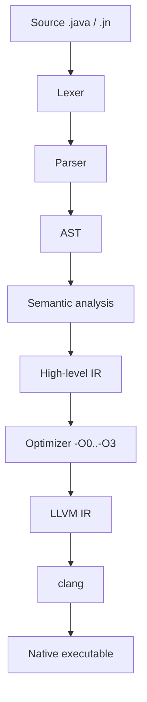

# JNative

**JNative** is an experimental **Java-like programming language** and **ahead-of-time (AOT) native compiler**.

It compiles a **subset** of Java-style source (`.java` / `.jn`) to a **native executable** via LLVM/`clang`. Generated programs do **not** require a JVM or JRE at runtime.

> **Not Java SE.** JNative is not a complete Java Standard Edition implementation and does not run arbitrary JARs.

[中文说明](README.zh-CN.md) · [Getting Started](docs/en/getting-started.md) · [Architecture](docs/en/architecture.md) · [Roadmap](docs/en/roadmap.md) · [Contributing](CONTRIBUTING.md)

---

## Why JNative?

**Java-like syntax, native executables, and a modern compiler architecture.**

- Familiar `class` / `main` / `System.out.println` style for Java developers
- AOT pipeline to machine code (no JVM at runtime)
- Explicit runtime: GC, exceptions, threading, FFI — documented as implemented, not assumed from the JDK

Motivation: explore how far a Java-shaped language can go as a **native compiler** project (LLVM backend, precise GC, effects annotations) without claiming full JDK compatibility.

---

## Current status

CLI reports **`JNative 0.32`** (`java -jar target/jnative.jar --version`). Maven `pom.xml` may lag; treat the CLI version as authoritative.

| Area | Status |
|------|--------|
| Lexer / Parser / AST | ✅ Implemented |
| Semantic analysis / type checking | ✅ Implemented |
| High-level IR + optimizers (`-O0`…`-O3`) | ✅ Implemented |
| LLVM backend → native executable | ✅ Implemented (verified: **macOS arm64**) |
| Classes, inheritance, arrays, casts | ✅ Implemented |
| Interfaces (no default/static interface methods) | ✅ Implemented |
| Generics (basic; wildcards experimental) | ✅ Implemented / 🚧 Experimental wildcards |
| Lambdas / method references (SAM) | ✅ Implemented |
| Exceptions (`try`/`catch`/`finally`, TWR decl form) | ✅ Implemented |
| Garbage collection (generational GC2 default) | ✅ Implemented |
| Native FFI (`@Native`, native structs) | ✅ Implemented |
| File I/O / TCP networking / HTTP stdlib | ✅ Implemented (stdlib; maturity varies) |
| Multithreading (`Thread`, mutexes, STW GC) | ✅ Implemented |
| `wasm32-browser` export | 🚧 Experimental |
| Package manager CLI | 🚧 Experimental |
| Multi-OS CI (Linux / Windows gates) | 📋 Planned |
| Full Java SE / arbitrary JARs | 📋 Not a goal |

Legend: ✅ Implemented (with tests on at least one host) · 🚧 In progress / experimental · 📋 Planned or out of scope.

Details: [Language overview](docs/en/language.md) · [Fact inventory (ZH)](docs/developer/FACT_INVENTORY.md)

---

## Hello, World

Actual syntax used by the project templates (verified against the current compiler):

```java
public class Main {
    public static void main(String[] args) {
        System.out.println("Hello, JNative!");
    }
}
```

```bash
mvn -q -DskipTests package
java -jar target/jnative.jar examples/guide-hello/src/Main.jn -o Hello
./Hello
# → Hello, JNative!
```

---

## From source to native executable



In short: the frontend builds an AST and typed program; lowering produces JNative IR; optional optimization passes run; the LLVM backend emits IR that `clang` links into a **native executable**. Runtime support (GC, exceptions, I/O) is linked from the project’s native runtime — not from a JVM.

See [Architecture](docs/en/architecture.md).

---

## Requirements

- **Java 21+** (to run the compiler JAR)
- **Maven 3.9+** (to build the compiler)
- **`clang` on `PATH`** (to produce native executables)
- Host verification today is strongest on **macOS arm64**. Linux/Windows are not claimed as fully gated in CI yet.

```bash
mvn package          # build compiler → target/jnative.jar
mvn test             # run the Java test suite (can take a while)
java -jar target/jnative.jar doctor
```

Full walkthrough: [Getting Started](docs/en/getting-started.md).

---

## Documentation

| Doc | Description |
|-----|-------------|
| [docs/en/](docs/en/README.md) | **English** public docs (authoritative) |
| [docs/zh-CN/](docs/zh-CN/README.md) | Chinese navigation / links |
| [docs/tutorial/](docs/tutorial/index.md) | Step-by-step tutorial (Chinese) |
| [website/](website/README.md) | VitePress doc site (Chinese-first today) |
| [docs/architecture.md] | Deeper architecture notes |
| [docs/language-support.md] | Feature support matrix (audit) |

---

## Contributing

See [CONTRIBUTING.md](CONTRIBUTING.md). English-first Issues/PRs preferred. [中文贡献说明](CONTRIBUTING.zh-CN.md).

---

## Licensing

- **MIT** — [LICENSE](LICENSE)
- Copyright holder (original code): individual author — see [COPYRIGHT.md](COPYRIGHT.md), [NOTICE](NOTICE)
- Third-party: [THIRD_PARTY_NOTICES.md](THIRD_PARTY_NOTICES.md), [docs/legal/](docs/legal/)

Pull requests grant use under MIT; they do **not** by default assign copyright to the maintainer (no CLA today).
