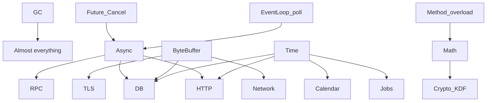

# JNative Architecture Debt

> Companion to [platform-status.md](platform-status.md)  
> Audit date: 2026-10-07  
> Severity: evidence-based; prefer under-claiming.

## Priority legend

| Pri | Meaning |
|---|---|
| **P0** | Wrong codegen, memory/GC/data corruption, security-critical defect |
| **P1** | Compiler crash, deadlock, resource leak, incorrect semantics, major cross-platform break |
| **P2** | Missing core capability that blocks L3 on foundational modules |
| **P3** | Product gaps, DX, optional ecosystems (MQ, extra DBs, widgets) |

**Repair order (mandatory):**

```text
P0 → P1 → Core L0 → Core L1 → Core L2 → L3 → L4 → new feature
```

**Core Freeze:** until Core targets progress, pause new syntax / new DB / new MQ / new UI widget families unless fixing a real demo blocker.

---

## P0 — Critical (investigate / fix first)

| ID | Issue | Evidence | Impact |
|---|---|---|---|
| P0-1 | **JSON `getLong` historically truncated via int path** | Fix present (`JsonNumber.literal` + `JsonParseLong`); **no regression test for >INT_MAX / epoch millis** | Silent data corruption in calendars, IDs, money-as-long |
| P0-2 | **GC absent on Windows** | No `jnative_gc*` under `native/windows` | Any Windows managed app is unsafe / impossible at production bar |
| P0-3 | **Password PBKDF2 iteration default documented as very low (e.g. ~500) due to crash risk** | `CryptoLib` comments | Security-critical if used for real auth as-is |
| P0-4 | **Host-mirror security tests can green-wash crypto/WS** | `Security025SuiteTest` et al. assert JVM mirrors | False confidence → ship broken native crypto |

*Note: P0-1 is “regression risk” until a native e2e proves the fix. Treat as P0 until closed with test.*

---

## P1 — High

| ID | Issue | Evidence | Impact |
|---|---|---|---|
| P1-1 | **epoll EventLoop stub on Linux** | `jnative_poll_epoll.c` PARTIAL; wait returns 0 | Async/net unusable on Linux |
| P1-2 | **IOCP EventLoop stub on Windows** | `jnative_poll_iocp.c` PARTIAL | Async/net unusable on Windows |
| P1-3 | **No Windows TLS backend** | Only `posix/jnative_tls.c` | HTTPS impossible on Windows |
| P1-4 | **PostgreSQL SCRAM unsupported** | Explicit marker in driver/tests | Cannot auth to modern PG defaults |
| P1-5 | **Dual Future + dual CancellationToken** | Builtin `Future` + `JnFuture`; Async + Io cancel types | Incorrect composition, leaks, lost cancel |
| P1-6 | **Method overloading rejected** | SemanticAnalyzer hard error | Blocks Math and sane stdlib APIs; forces ugly names |
| P1-7 | **break/continue absent** | No tokens | Incorrect/awkward control flow; loop codegen debt |
| P1-8 | **Time DST / IANA absent** | TimeLib fixed offsets; DST PARTIAL | Calendar/Jobs/HTTP date bugs |
| P1-9 | **No ByteBuffer / unified buffer model** | Stdlib scan: no ByteBuffer | Network/TLS/DB/compression integration debt |
| P1-10 | **Optimizer correctness under -O tiers under-tested** | `OptimizerEndToEndTest` ~2 tests | Miscompile risk at -O2/-O3 |
| P1-11 | **Stale docs (language-support.md)** | Claims no TLS/WS/collections | Misleads contributors; not a runtime bug but process risk |

---

## P2 — Core capability gaps (L0–L1 that block “trust”)

| ID | Gap | Current | Why central |
|---|---|---|---|
| P2-1 | Math | L0 | Every numeric app |
| P2-2 | StringBuilder | L0 | String-heavy servers/UI |
| P2-3 | try-with-resources | L0 | Resource safety ergonomics |
| P2-4 | records / pattern matching | L0 | Modern DTOs (can wait vs Math/Time) |
| P2-5 | typesystem test corpus | Missing | Compiler trust |
| P2-6 | Live TLS / live PG e2e gates | Missing | Web/DB trust |
| P2-7 | WatchService e2e | L1–L2 | Explorer correctness |
| P2-8 | Async exception/cancel/finally matrix | Thin | Entire async stack |
| P2-9 | Collections concurrency / fail-fast / large-N | Partial | Server workloads |
| P2-10 | GC dashboard + soak harness | Partial | Production ops |

---

## P3 — Ecosystem / product (do not prioritize over Core)

| ID | Item | Level | Note |
|---|---|---|---|
| P3-1 | MySQL | L0 | Explicitly rejected — OK to stay L0 |
| P3-2 | Redis / Kafka / Rabbit / Jobs framework | L0 | After Core L3+ |
| P3-3 | HTTP/2 live sessions | L2 frames only | After TLS e2e |
| P3-4 | Argon2 / AES / modern AEAD | L0 / PLANNED | After SecureRandom native e2e + better KDF |
| P3-5 | Tracing / Prometheus | L0 | After logs structured |
| P3-6 | New UI widget families | — | Freeze unless demo blocker |
| P3-7 | Full Studio IDE parity | L2–L3 | After editor/FS/diagnostics L3+ |

---

## Top 20 Weaknesses

Ranked by **severity × dependency centrality × real-app impact** (not “lowest letter first”).

| Rank | Weakness | Why it outranks lower maturity toys |
|---|---|---|
| 1 | **GC not portable (no Windows) + soak/metrics thin** | Everything allocates |
| 2 | **EventLoop poll stubs (epoll/IOCP)** | Blocks portable async HTTP/DB/RPC |
| 3 | **Dual Future / Cancellation models** | Corrupts every async composition |
| 4 | **No Math (+ overload ban)** | Blocks numeric stdlib & API design |
| 5 | **Time L1 (no DST/IANA/tests)** | Calendar, HTTP, jobs, DB timestamps |
| 6 | **ByteBuffer / buffer model missing** | Net/TLS/DB/compression hinge |
| 7 | **TLS unproven (no handshake e2e; no Win)** | Cannot claim HTTPS |
| 8 | **PostgreSQL SCRAM missing + no live PG gate** | Real DB deployments fail auth |
| 9 | **JSON numeric correctness under-tested** | Silent long corruption |
| 10 | **Crypto production posture weak (low PBKDF2; host mirrors)** | Auth demos ≠ secure |
| 11 | **Exceptions not L4 at async/native boundaries** | Heisenbugs in servers |
| 12 | **Optimizer under-tested across -O levels** | Silent miscompile |
| 13 | **StringBuilder missing; string suite empty dir** | Perf + correctness for text |
| 14 | **Collections missing concurrent / tree / PQ; hardening thin** | Server scale |
| 15 | **Language control gaps (break/continue, try-with-resources)** | Everyday code quality |
| 16 | **Cross-platform CI matrix absent** | macOS-only confidence |
| 17 | **WatchService untested in jnative e2e** | Explorer integrity |
| 18 | **RPC runtime e2e thin (REST mirrors)** | Fullstack story incomplete |
| 19 | **Observability near-zero (no trace, weak metrics)** | Cannot operate services |
| 20 | **10k semantic corpus absent** | Long-term compiler asset missing |

*(Kafka/MySQL/Redis at L0 are intentionally **below** this list.)*

---

## Critical Path — Top 10 things blocking production-ready JNative

```text
1. Portable GC + root/stress proof (incl. Windows plan)
2. Real EventLoop on epoll + IOCP (kill PARTIAL stubs)
3. One Async Model (Future + Cancellation + Deadline)
4. Method overload (unlock Math & stdlib APIs)
5. Math + numeric tests
6. Time (IANA/DST) + boundary tests
7. Unified ByteBuffer + IO hardening
8. TLS live e2e (+ Windows strategy)
9. PostgreSQL SCRAM + live DB gate (or honestly SQLite-only product bar)
10. Cross-platform CI matrix + compiler/runtime reliability metrics
```

Until these move, **new databases / MQ / widget kits do not increase trust**.

---

## Dependency centrality (why order matters)



---

## Duplicate Abstractions (action)

| Action | Detail |
|---|---|
| Merge | Language `Future` ↔ `JnFuture` surface (one docs + one user type) |
| Merge | `JnCancellationToken` ↔ `IoLib.CancellationToken` |
| Add | Single `Deadline` / timeout primitive |
| Do not add | Promise/AsyncResult/Task as a third future |
| Add (gap) | `ByteBuffer` — this is missing, not duplicate |

---

## Compiler Intrinsics (debt view)

- Keep `NativeIntrinsic` small; prefer IR → runtime `jnative_*`.
- Watch for **application semantics leaking into LLVM** (currently mostly memset + runtime calls — healthy).
- FFI-intrinsic String methods need a published inventory in platform-status (done) and must not fork per backend.

---

## Runtime Native Dependencies (risk)

| Risk | Mitigation order |
|---|---|
| OpenSSL only on posix | TLS e2e + Windows plan |
| SQLite via system FFI | Pin version + ownership rules |
| UI Cocoa vs Win32 drift | Shared headless e2e contract |
| Poll stubs | Implement or fail-fast at runtime with clear errors |

---

## Cross-Platform Gaps

| Gap | Status |
|---|---|
| Linux async poll | Stub |
| Windows async poll | Stub |
| Windows GC | Missing |
| Windows TLS | Missing |
| Windows process e2e | `/bin/echo` bias |
| Linux/Windows CI gate | Missing |
| arm64 Linux matrix | Missing |

---

## Test Coverage Gaps (actionable)

1. Create `src/test/java/io/jnative/typesystem/` corpus (grow toward 10k long-term).
2. Native e2e: `getLong`, Time DST/boundaries, Math, TLS handshake, SCRAM/live PG.
3. Replace or dual-track host-mirror security tests with native binaries.
4. Optimizer identity suite: `-O0` vs `-O2` vs `-O3`.
5. Async cancel/exception/finally + multi-thread GC soak.
6. Publish weekly metrics table (platform-status §23).

---

## Real Application Status (honest)

| App | Blocks production narrative? |
|---|---|
| Explorer | Proves desktop FS/UI on macOS path; not a multi-OS product proof |
| Notepad | Proves editor stack; good dogfood |
| Scheduler | Proves HTTP+SQLite+browser shell; **does not** prove full WASM↔RPC↔PG chain |
| Chat | Proves WS+auth demo; crypto posture not production |
| Studio | Early IDE; depends on process/FS/editor |

---

## Recommended Hardening Order

### Wave 0 — Stop the bleeding (P0/P1)

1. Native regression test for JSON `getLong` / large literals.  
2. Fail loudly on epoll/IOCP stub (no silent `return 0` success).  
3. Document/disable insecure PBKDF2 defaults for non-demo builds.  
4. Inventory and label all host-mirror tests as non-native.

### Wave 1 — Core trust foundation

1. Unify Future + Cancellation + Deadline.  
2. Implement epoll EventLoop (Linux).  
3. Method overloading.  
4. Math module + tests.  
5. Time IANA/DST + tests.  
6. ByteBuffer.  
7. GC soak + metrics; Windows GC plan.

### Wave 2 — Servers become believable

1. TLS handshake e2e.  
2. HTTP/WS native e2e (reduce host mirrors).  
3. PostgreSQL SCRAM + live gate **or** product decision: SQLite-only.  
4. Exception async/native matrix.  
5. Optimizer -O identity.

### Wave 3 — Expand (only after Wave 1–2)

1. IOCP + Windows TLS/GC.  
2. Cross-platform CI matrix.  
3. Collections hardening / StringBuilder.  
4. Observability (structured log → metrics → trace).  
5. Then Redis/Jobs/HTTP2-live/Studio depth — **not before**.

### Explicit non-goals until Core L3+

- MySQL, Kafka, RabbitMQ, generic JobManager product, new widget kits, new syntax toys (records/pattern) unless unblocking demos.

---

## Next question after this audit

Do **not** ask: “What feature do we add next?”

Ask:

> **Which L1/L2 foundational capability most blocks trusting all of JNative?**

Then fix **one** node on the critical path.

---

```text
JNATIVE_PLATFORM_AUDIT_COMPLETE
```
