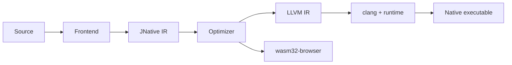

# Architecture

JNative is an **ahead-of-time compiler** implemented in Java. It accepts a Java-like source subset (`.java` / `.jn`), lowers it through a private IR, and produces either:

- a host **native executable** (LLVM IR → `clang` → link), or
- an experimental **`wasm32-browser`** artifact (WASM + JS glue).

Programs do **not** ship a JVM. The compiler itself runs on a JVM (Java 21+) only as a build-time tool.

This page describes the **current** tree under `src/main/java/io/jnative/`. Speculative work is called out at the end.

---

## End-to-end pipeline

Driver: `io.jnative.compiler.JNativeCompiler`.

```text
Source units (.java / .jn)
        │
        ▼
 LayoutConfig          native64  or  wasm32 pointer/layout
        │
        ▼
 Target capability check   (reject unsupported APIs for the chosen target)
        │
        ▼
 MultiUnitFrontend         lex → parse → AST → semantic analysis
   (+ embedded stdlib)
        │
        ├─ optional annotation processors / generated sources  → re-analyze
        ├─ optional RPC codegen                                → re-analyze
        ▼
 EffectAnalyzer            @NoGC / @NoThrow / … contracts
        │
        ▼
 GenericLowering           specialize / erase generics for IR
        │
        ▼
 IrGenerator               high-level JNative IR
        │
        ▼
 AsyncLoweringPass         async/await lowering (when used)
        │
        ▼
 OptimizationPipeline      -O0 skips; default single-file -O2
        │
        ├── wasm32-browser ──► Wasm backend + JS glue ──► dist/
        │
        └── native ──────────► LlvmIrGenerator ──► .ll
                                      │
                                      ▼
                               NativeLinker (clang + runtime .c/.m)
                                      │
                                      ▼
                               native executable
```

IDE analysis (`analyze` / `jnative analyze` / LSP) stops after the frontend: **no IR, LLVM, or link**.



---

## Package map (source of truth)

| Package | Responsibility |
|---------|----------------|
| `lexer` / `parser` / `ast` | Tokens, recursive-descent parse, AST |
| `semantic` | Types, members, overloads, inheritance, effects, exception CFG |
| `generic` | Generic lowering before IR |
| `layout` / `vtable` / `iface` | Object layouts, vtables, interface tables |
| `ir` | High-level IR + async lowering |
| `opt` (+ `opt.cfg`) | Escape analysis, scalar replace, stack alloc, CHA/devirt, inline, DCE, check/safepoint elim |
| `backend.llvm` | LLVM text emission, debug metadata, runtime emitters |
| `backend.wasm` | Browser WASM path |
| `ffi` | Target ABI / native struct layouts |
| `stdlib` | Bundled library sources included by the frontend |
| `cli` / `build` / `pkg` / `mobile` / `lsp` | Tooling around the compiler core |

Native C/ObjC runtime sources live under `src/main/resources/native/` (`posix/`, `windows/`).

---

## Frontend

1. **Stdlib inclusion** — user units are combined with bundled stdlib via `MultiUnitFrontend.withStdlib`.
2. **Independent multi-file parse** — each compilation unit is parsed on its own; symbols are resolved across the program (`MultiUnitFrontend`, project builds).
3. **Semantic analysis** — produces `TypedCompilationUnit` with class metadata (including flattened managed reference offsets for GC).
4. **Effects** — `EffectAnalyzer` validates annotations such as `@NoGC` / `@NoThrow` against the call graph.

What the frontend deliberately is **not**: a Java SE type checker for the full JDK, or a consumer of arbitrary third-party JARs.

---

## Middle end

### IR

`IrGenerator` builds a module of functions, blocks, and typed ops. Exception handling is already encoded as an explicit CFG (pending-exception style). LLVM does **not** re-run Java catch resolution.

### Optimizations (`io.jnative.opt`)

Default opt level for single-file compile options is **`-O2`** (`CompilerOptions`). Roughly:

| Level | Behavior |
|-------|----------|
| `-O0` | Skip IR opts (useful as a reference / with `--debug`) |
| `-O1+` | Escape analysis, constprop, scalar replacement, CHA/exact-type devirtualization, null-check elim, DCE |
| `-O2+` | Safe inlining, bounds/safepoint elim, stack allocation of non-escaping managed objects, whole-program DCE |

`clang` is invoked with a matching `-On`. Details: [`../optimizer.md`](../optimizer.md).

---

## Native backend

1. `LlvmIrGenerator` emits LLVM IR with class metadata, shadow-stack root slots, and calls into the GC / exception / I/O runtimes.
2. Optional `llvm` verify step on the `.ll` file.
3. `NativeLinker` shells out to the detected toolchain (`clang`), linking compiled runtime objects and frameworks as needed (e.g. Cocoa for desktop UI on macOS).

Invariants that matter for contributors:

- Managed layout is decided in Java (`ClassLayout`); native structs use ABI layouts and are **not** GC-traced as Java references.
- All managed heaps allocations are enumerable; roots are **precise** (shadow stack + updatable slots), not a conservative stack scan.
- Blocking native work transitions the thread into a NATIVE state so stop-the-world GC does not wait on it forever.

---

## Runtime (linked into apps)

| Area | Implementation sketch |
|------|------------------------|
| **GC** | Default **GC2**: TLAB + young semi-space copy + old mark-sweep (`JNATIVE_GC=generational`). Legacy `marksweep` retained. |
| **Exceptions** | Pending exception + IR CFG; see [`../exceptions.md`](../exceptions.md) |
| **Threads** | POSIX threads (`jnative_mt.c`), per-thread `ThreadState`, safepoint polls |
| **FFI** | `@Native` → `NativeCall`; `@NativeStruct` / `NativePtr` unmanaged |
| **File / TCP** | Runtime emitters → platform C layer (no raw `FILE*` / `SOCKET` in the language API) |
| **HTTP** | Stdlib on top of TCP — **not** compiler intrinsics |

Windows and some Linux async/poll paths still have documented stubs; treat secondary OS support as incomplete until CI proves otherwise ([`../1.0-release-blockers.md`](../1.0-release-blockers.md)).

---

## Alternate target: `wasm32-browser`

When `--target wasm32-browser` is selected, layout switches to wasm32, the host LLVM/link path is skipped, and `backend.wasm` emits WASM plus JS glue for browser shells. This powers sample cores (e.g. guide-tasks / sudoku), not a browser JDK.

---

## Tooling around the compiler

| Surface | Role | Maturity |
|---------|------|----------|
| `jnative build` / `new` / `doctor` | Project workflow | Primary native path verified on macOS arm64 |
| `jnative analyze` / `lsp` | Frontend diagnostics for editors | Experimental IDE depth |
| `jnative add` / package registry | Dependency packaging | Experimental |
| `jnative mobile …` | WebView container builds | Experimental |

Language `package` declarations are **not** the same thing as package-manager coordinates.

---

## Planned / incomplete (do not document as done)

- Multi-OS CI gates (Linux / Windows / macOS x64)
- Completing Windows GC/sockets and Linux epoll where still stubbed
- Richer LSP (navigation/refactor beyond analyze-oriented flows)
- Production-hardened package ecosystem

See [roadmap.md](roadmap.md).

---

## Related deeper notes

Older, denser write-ups (still accurate for subsystems): [`../architecture.md`](../architecture.md), [`../gc2.md`](../gc2.md), [`../ffi.md`](../ffi.md), [`../threading.md`](../threading.md), [`../jnative-multi-cu-architecture.md`](../jnative-multi-cu-architecture.md).
